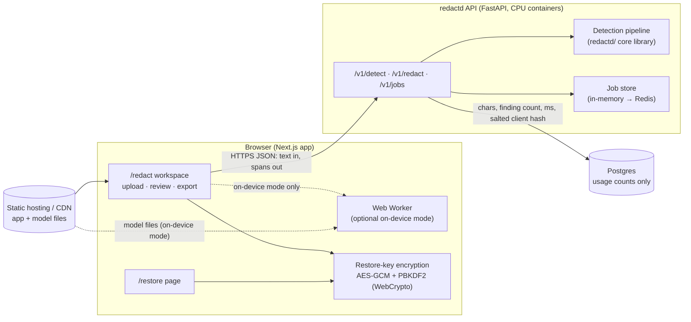
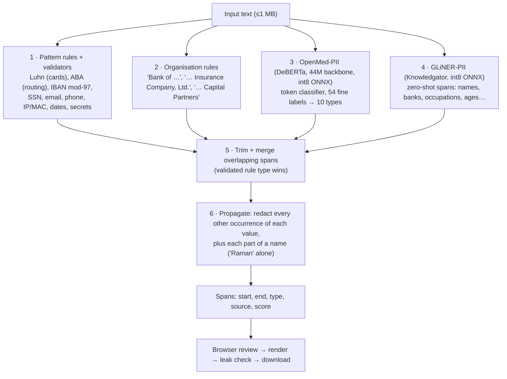
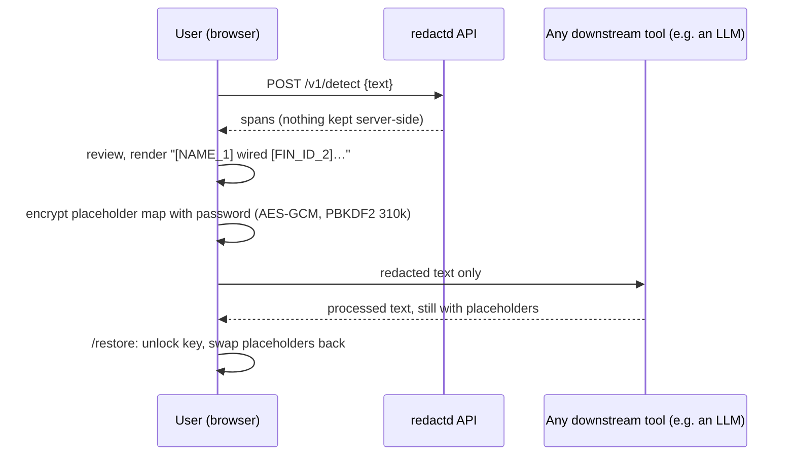

# redactd architecture

## 1. System overview

**Who does what**

| Layer | Responsibility | Never does |
|---|---|---|
| Browser | File input, review UI (accept/reject/add), rendering the redacted output, leak check, encrypting the restore key, restoring | Store documents anywhere |
| API | Runs detection (rules + models) and returns character spans; async jobs for large files | Store or log text, spans or values; see restore keys |
| Database | Usage metering (characters, number of findings, timing, salted client hash) | Hold any document content |

Detection runs on the backend by default. On-device mode runs the same pipeline in a Web Worker for users who want zero data transfer, at the cost of a one-time model download of up to 370 MB.

## 2. Detection pipeline (`redactd/pipeline.py`, mirrored in `apps/web/workers/detect.worker.ts`)

| Mode | Stages | Typical latency (≈700-char email, warm, 2 threads) |
|---|---|---|
| Fast | 1–2 | < 5 ms |
| Standard | 1–3, 5–6 | ≈ 0.1–1 s |
| Thorough (default) | 1–6 | ≈ 0.7–0.9 s |

**Why an ensemble.** No single model reached 95% on held-out financial text: OpenMed-Small was strong on direct identifiers (92%) but weak on indirect ones (47%); GLiNER-PII was the reverse (84% / 85%). The union of all four detectors, plus propagation, covers both — see §5.

**Output styles** (`redactd/vault.py`, `apps/web/lib/redact.ts`):

| Style | Example | Reversible? |
|---|---|---|
| Placeholder | `[NAME_1]` — same value → same placeholder within a document | Yes, with the restore key |
| Label | `[NAME]` | No |
| Block | `██████` | No |

**Leak check.** Before download, every redacted value (≥3 chars) is searched for in the output. If any survives, the download button is disabled.

## 3. Two-way (reversible) redaction

The server never sees the placeholder map or the password. Losing the key file or the password means the originals can't be recovered, by design.

## 4. API

| Endpoint | Purpose |
|---|---|
| `GET /health` | Liveness + which modes have warm models |
| `POST /v1/detect` | `{text, mode, sensitivity}` → spans + per-stage timings (≤200k chars) |
| `POST /v1/redact` | Same input + `style` → redacted text, placeholder map (placeholder style only), leak count |
| `POST /v1/jobs`, `GET /v1/jobs/{id}` | Async detection for large documents; the result is deleted once collected or after a 10-minute TTL |

Safeguards in `apps/api/app/main.py`:
- The access log records metadata only: method, path, status, timing and a salted client hash.
- Errors return a generic message that never echoes document text.
- Rate limiting is per client, and request size is capped (1 M chars).
- A semaphore limits concurrent model runs.
- CORS is restricted to the web origin, and responses carry `Cache-Control: no-store`.

## 5. Accuracy (from `bench/`, reproducible)

The test sets are public synthetic financial datasets: Gretel `synthetic_pii_finance_multilingual` (Apache-2.0) and NVIDIA Nemotron-PII finance domains (CC-BY-4.0).

**Recall** is the share of labelled identifiers caught, label-agnostic. "≥50%" counts an identifier as caught when at least half of its characters are redacted; "≥90%" is the stricter version.

| Held-out Gretel finance (300 docs never used for tuning) | Direct ≥50% | Direct ≥90% | Indirect ≥50% | Indirect ≥90% |
|---|---|---|---|---|
| Rules only | 26.7% | 23.2% | 16.7% | 15.8% |
| OpenMed-Small only | 91.9% | 83.2% | 46.8% | 40.7% |
| GLiNER-PII only | 84.1% | 69.8% | 85.5% | 81.5% |
| **Full pipeline, raw labels** | **98.9%** | 94.2% | 92.6% | 90.9% |
| **Full pipeline, policy-adjusted labels\*** | **99.6%** | **95.9%** | **98.8%** | **98.0%** |

\*`bench/gold_policy.py` removes template placeholders (`[JURISDICTION]`) from any label. For company labels only, it also removes generic phrases ("sales department") and public bodies (ISDA, HMRC, the US Treasury). It drops 21 of 962 direct and 53 of 551 indirect labels.

**Precision.** 35% of redacted characters on Gretel, 74% on Nemotron. The pipeline is deliberately biased towards over-redaction, and the review screen is where users trim it. Part of the Gretel gap is real PII that the dataset left unlabelled.

## 6. Deployment

| Component | Target | Notes |
|---|---|---|
| Web app | Vercel or Cloudflare Pages | Must send COOP/COEP headers (set in `next.config.mjs`) for multi-threaded WASM in on-device mode |
| Model files (on-device mode) | Cloudflare R2 + CDN | Set `NEXT_PUBLIC_MODEL_BASE` |
| API | Fly.io / Cloud Run, `apps/api/Dockerfile` | 4 vCPU / 8 GB per instance; 1 uvicorn worker per instance, scale horizontally; models baked into the image |
| Database | Postgres (Neon / Supabase) | `DATABASE_URL=postgresql+psycopg://…`; usage table only |
| Job store | Redis (Upstash) when running more than one API instance | Same interface as `apps/api/app/jobs.py` |

## 7. Known gaps / next steps

- **Model size for on-device mode (≈370 MB):** compress the embedding matrices, or replace OpenMed with our own smaller DeBERTa. The first training run failed because transformers v5 loads fp16 weights by default; it's fixed and retraining now.
- **Partial account numbers** ("ending 4471") are redacted but labelled as ADDRESS; this needs a dedicated rule and type.
- **Over-redaction:** add a precision pass (for example, ignore well-known public institutions and offer an allow-list per user).
- **Auth, billing and API keys** aren't built yet; the usage table is ready for metering.
- **The SLM verifier** (Qwen 1.5B via llama.cpp, `bench/slm.py`) is built but not yet benchmarked on the full sets. It's intended to run only on low-confidence chunks.
