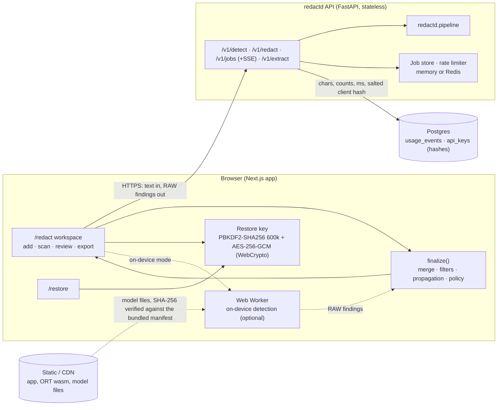
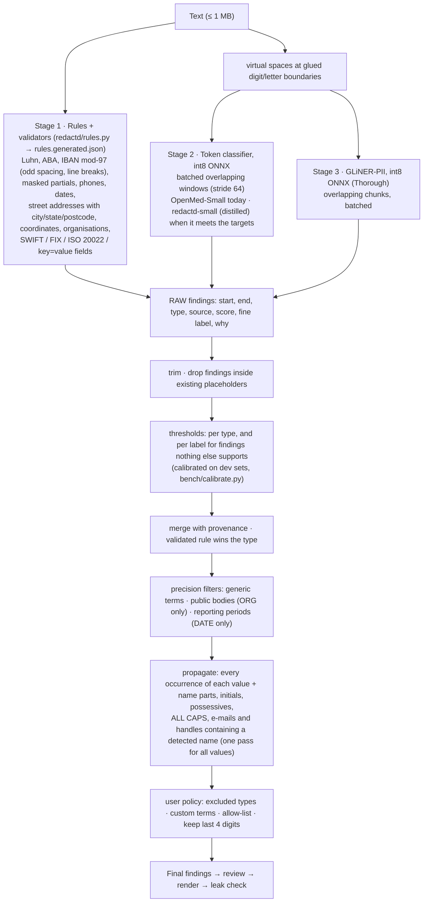

# redactd architecture

## 1. System overview



| Layer | Does | Never does |
|---|---|---|
| Browser | Input, policy (presets, custom terms, allow-list, keep-last-4), review, rendering, leak check, restore key, restore | Store documents; send terms, decisions, output or keys anywhere |
| API | Rules + models → findings; text extraction from DOCX/PDF/EML/MSG; async jobs with progress | Store or log text, findings or values; call a hosted LLM; see restore keys |
| Database | Usage metering, API key hashes and quotas | Hold content |

The web app asks the API for **raw** findings (`raw: true`) and applies the policy itself with `finalize()`. The
same function exists in Python (`redactd/post.py`) and TypeScript (`apps/web/lib/redact.ts`) and is parity-tested,
so API-only callers get identical results from the server.

## 2. Detection pipeline

`redactd/pipeline.py`; mirrored by `apps/web/workers/detect.worker.ts` + `apps/web/lib/redact.ts`.



Stage 4 of the target architecture (an SLM verifier on low-confidence chunks) is not shipped: see section 7.

| Mode | Models | Use |
|---|---|---|
| Fast | none | Structured identifiers only; instant; no download on device |
| Standard | token classifier | Names, places and context |
| Thorough (default) | token classifier + GLiNER-PII | Best recall |

Which models a mode runs is configuration (`REDACTD_STANDARD`, `REDACTD_THOROUGH`), not code.

**One rule set, two engines.** `redactd/rules.py` is the only place rules are written. `python -m redactd.rules
--export` generates `apps/web/lib/rules.generated.json` (rules, word lists, thresholds, label maps), which
`lib/rules.ts` executes. Patterns follow a portability contract (ASCII classes, no `$`, bounded quantifiers, one
capture group). `tests/test_rule_parity.py` runs both engines on every fixture and all 2,060 eval documents and
requires identical rule findings, final findings, rendered output and leak-check result.

**Output styles** (`redactd/vault.py`, `lib/redact.ts`): `[NAME_1]` placeholders (reversible; the same value gets
the same placeholder; numbers already present in the document are skipped), `[NAME]` labels, or `██████` blocks.

**Leak check.** After rendering, every redacted value is searched for again in the output with the same matching
rules as propagation. Any hit blocks the download in the UI and fails the CI gate.

## 3. Review experience (`apps/web`)

* `components/Viewer.tsx` + `lib/layout.ts`: monospace soft-wrap into fixed-height rows with exact offsets; only
  visible rows are in the DOM. Minimap canvas with per-category marks. Side-by-side diff on the same rows.
* `lib/review.ts`: reducer with a 200-step undo/redo stack. Keyboard: `j`/`k`, `n`, `x`, `Shift+x`, `a`/`Shift+a`,
  `1`–`9`, `/`, `u`/`Shift+u`, `d`, `e`, `?`.
* `components/Sidebar.tsx`: bulk actions per category, needs-review queue (lowest confidence first) with a
  confidence filter, bulk actions per exact value.
* `lib/presets.ts`: Standard, Share with LLM, Legal production, Analytics. Changing a preset re-runs `finalize()` on
  the cached raw findings and keeps the user's decisions.
* `lib/report.ts`: exported report with counts, leak-check result, versions and timestamp; never values.
* `lib/models.ts`: on-device model files are verified against SHA-256 hashes shipped in the bundle, then cached.

## 4. Two-way (reversible) redaction

```mermaid
sequenceDiagram
  participant U as User (browser)
  participant A as redactd API
  participant X as Any downstream tool (e.g. an LLM)
  U->>A: POST /v1/detect {text, mode, raw: true}
  A-->>U: raw findings (nothing kept server-side)
  U->>U: finalize with the chosen policy, review, render "[NAME_1] wired [FIN_ID_2]…"
  U->>U: leak check; encrypt placeholder map with a password
  U->>X: redacted text only
  X-->>U: processed text, still with placeholders
  U->>U: /restore: unlock key, swap placeholders back (byte-exact)
```

## 5. API

| Endpoint | Purpose |
|---|---|
| `GET /health` | Liveness, warm modes, component versions |
| `POST /v1/detect` | `{text, mode, sensitivity, raw?, org_allowlist?, drop_nonpersonal_dates?, keep_last4?, custom_terms?, allow_terms?, exclude_types?}` → findings with provenance, timings, versions (≤ 200k chars) |
| `POST /v1/redact` | Same + `style` → redacted text, placeholder map (placeholder style only), leak count |
| `POST /v1/jobs` → `GET /v1/jobs/{id}/events` → `GET /v1/jobs/{id}` | Large documents: SSE `progress {stage, pct}` then `done`; the result is delivered once and deleted (TTL 10 min) |
| `POST /v1/extract` | DOCX, PDF text layer, EML, MSG, CSV/JSON → text, in memory; attachment content only on request |

Auth: `Authorization: Bearer rk_…` (SHA-256 hash stored, per-key rate and monthly character quota), or anonymous
with a stricter per-IP limit. Logs are JSON lines with an allow-listed set of metadata fields (`app/obs.py`).

## 6. Accuracy and performance

The numbers live in generated files so they cannot go stale here:

* `bench/out/report.md` — recall per tier at ≥50% / ≥90% coverage and character precision, raw and policy-adjusted
  labels side by side, per coarse type, fine label and document type, latency percentiles, leak regression, and
  the notes on what did not work. Regenerate with `python bench/report.py`.
* `bench/out/load.md` — API latency percentiles and throughput (`python bench/load_test.py`).
* `docs/RESULTS.md` — the summary of targets met and not met at the time of the last change.

## 7. Known gaps

* **Precision targets are not met** and raw-label direct recall on Gretel is just under target; see
  `bench/out/report.md` and its notes for why and for what was tried.
* **SLM verifier (B5)**: `bench/slm.py` exists but was not benchmarked in this round, so it stays off and is not
  shipped. It needs several CPU-hours per eval set.
* **Web app accounts** (Auth.js / Clerk) are not built. API keys and anonymous limits are.
* **Deliberate obfuscation** (homoglyphs, zero-width characters inside identifiers) is not normalised.
* **WebGPU**: the int8 models run on WASM; a WebGPU path is wired but needs an fp16 model file to be useful.
* Deployment is documented (`docs/DEPLOY.md`) but nothing has been provisioned.
